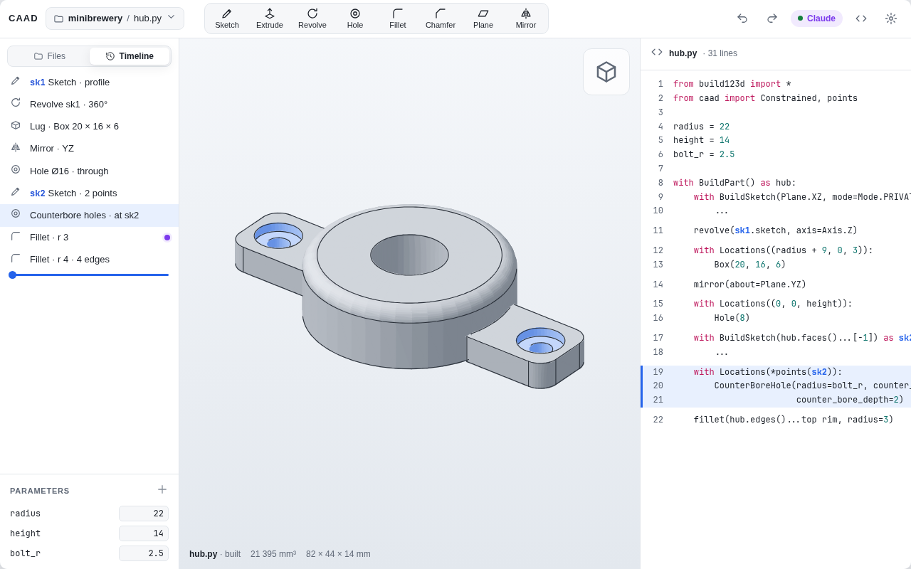
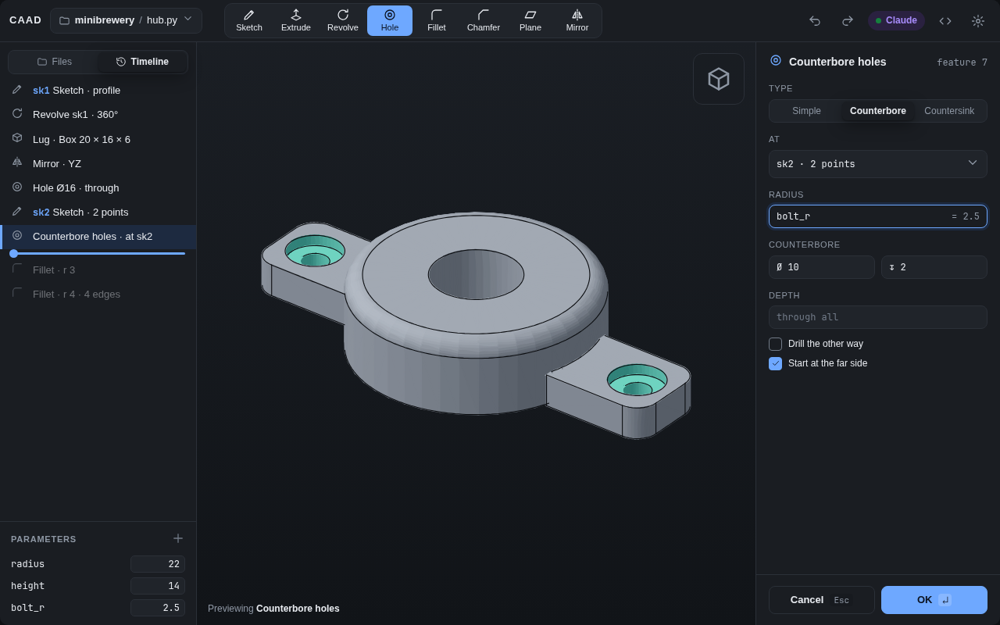
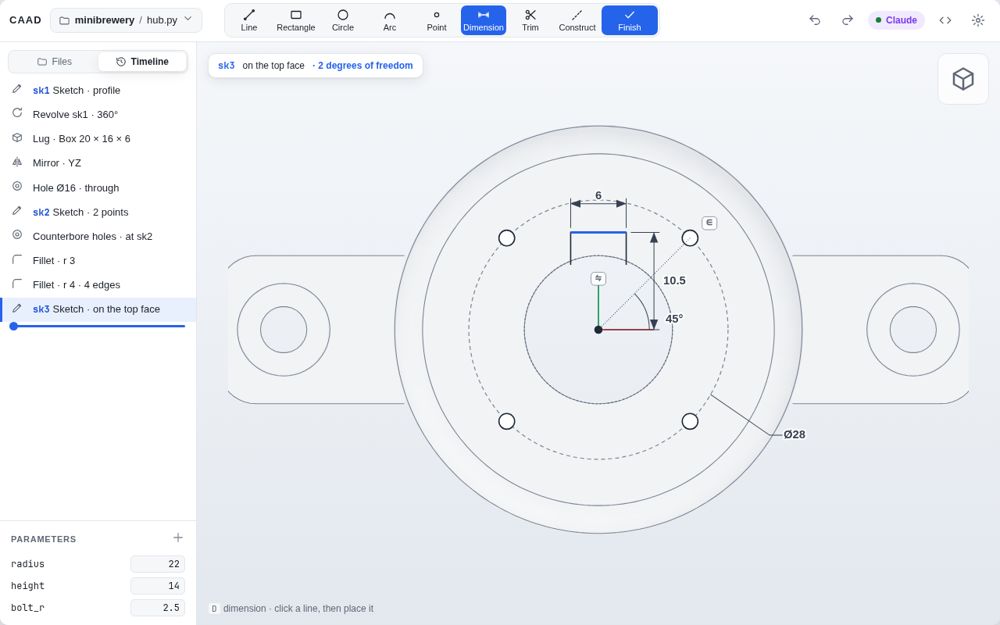
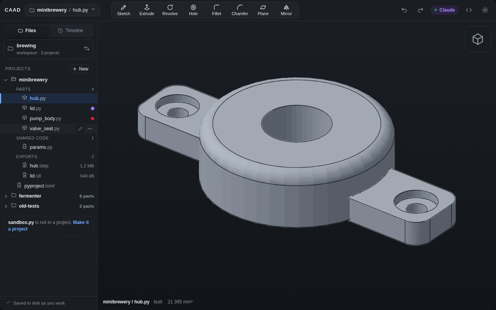

# CAAD — Visual system

**Date:** 2026-11-27
**Status:** Agreed: direction A ("Studio") chosen from the mock-ups; to be built in phase 1.5e (themes and layout) and 1.5f (the view)
**Part of:** [04 — Roadmap](04-roadmap.md), phase 1.5; follows [09 — Design goals, layout and workflow](09-design-and-workflow.md), whose goals every rule here serves

## The choice

Three directions were mocked up as static pages in `design/mockups/` (open `index.html`), each in light and dark with the same four scenes:
- **A, Studio:** calm and technical, a cleaned-up Onshape.
- **B, Islands:** floating glass panels over a full-window view.
- **C, Workshop:** warm and playful, with a bottom timeline and a pie menu.

**A was chosen.** Its strengths, against doc 09's goals:
- **Easy to learn and discover (goals 1 and 11):** labelled commands in a top bar, close to Onshape and SolidWorks, which CAAD's users know.
- **The part is never covered (goal 4):** the panels dock instead of floating over it.
- **Few surprises:** a quiet look that leaves the attention to the part.

A follow-up page, `a-projects.html`, worked out project and file management in A. That led to the rail's **Files | Timeline** switch: the stacked alternative was rejected.

The mock-ups stay as the reference until 1.5e has moved their tokens into the app:
- **Tokens and components:** `design/mockups/assets/studio.css`.
- **Scenes:** `a-studio.html` (part, dialog, sketch, context menu) and `a-projects.html` (files, new, rename, delete, new project, workspaces, first visit).
- **The rendered part:** `render.mjs` renders `part.py` with CAAD's own kernel, so the shading and edges in the mock-ups preview the real 3D look.

| | |
| :-- | :-- |
|  |  |
|  |  |

## Layout

```
┌ top bar (54 px) ─────────────────────────────────────────────────────────────────────────────┐
│ CAAD  [project / part ▾]  [ mode commands, icon + label … primary ]     ↶ ↷  ● Claude  </>  ⚙ │
├ rail (252 px) ─┬ view ───────────────────────────────────────────────┬ dock (312 / 380 px) ───┤
│ [Files|Timeline]│ sketch status                           view cube │ a dialog, or the code │
│                 │                                                    │                       │
│  tree, or the   │                    the part                        │                       │
│  timeline with  │                                                    │                       │
│  parameters     │ selection chip                                     │                       │
│  at its foot    │ status line                message (with Undo)     │                       │
└─────────────────┴────────────────────────────────────────────────────┴───────────────────────┘
```

- **Top bar:**
  - On the left: the name, then the open project and part. Clicking them opens the Files tab.
  - Then the mode's commands in one group, as icon and label buttons. A mode's primary action (*Finish* in a sketch) closes the group, filled with the accent colour.
  - On the right: undo and redo, the agent's status (a dot and its name), the code toggle and settings (theme).
  - Nothing else: build times go into the status line's tooltip.
- **Rail:** one panel with a switch between **Files** (the workspace: its projects and their files by kind, doc 07) and **Timeline** (the open part's features, its parameters at the foot). The rail can be collapsed; in slice mode Timeline becomes **Plate** ([11](11-slicing.md)).
- **View:** everything else.
  - The view cube sits top right, and the sketch status (sketch name, degrees of freedom) top left in sketch mode.
  - The status line sits bottom left: file, built, volume, size.
  - The selection chip shows above it only while something is selected: how many, and the selector.
  - Messages appear bottom centre.
- **Dock:** one thing at a time, docked on the right, never over the part.
  - **Dialogs** are 312 px wide.
  - **The code** is 380 px by default, resizable, and the width is remembered.
  - A dialog takes the dock while it is open; the code comes back when it closes. The view re-centres the part when the dock opens or closes.
- **Floating** are only menus, popovers (the workspace switcher, *New*), tooltips, the selection chip and messages.

## Colour

All colours are tokens: CSS custom properties on `:root`, redefined for the dark theme. The theme follows the system unless chosen in settings. The 3D view reads the same tokens (no colours in TypeScript), so the view, the sketch editor, the panels and the code always agree (goal 8).

### Surfaces and text

| Token | Light | Dark | For |
| :-- | :-- | :-- | :-- |
| `--view-top` / `--view-bottom` | `#f6f8fb` / `#e3e8ee` | `#1b1f25` / `#111418` | The view's vertical gradient |
| `--panel` | `#ffffff` | `#1a1d22` | Top bar, rail, dock, menus |
| `--panel-2` | `#f6f7f9` | `#20242a` | Sunken: inputs, segmented controls, hovered rows |
| `--line` | `#e2e6eb` | `#2b3038` | Borders, separators |
| `--text` | `#1b2028` | `#e6e9ee` | Text |
| `--muted` | `#5f6876` | `#8e97a4` | Secondary text: labels, meta, line numbers. **The lightest colour any text may use** |
| `--faint` | `#848c98` | `#717a87` | Icons, chevrons, checkbox borders, disabled. **Never text** |
| `--shadow` | soft, 2 layers | deeper | Only floating things (menus, popovers, chip, view cube) |

### Accent and states

| Token | Light | Dark | For |
| :-- | :-- | :-- | :-- |
| `--accent` | `#2563eb` | `#6ea8ff` | Selection, the active tool, primary buttons, focus |
| `--accent-soft` | `#e8f0fe` | `#1d2a40` | Selected and active rows, highlighted code lines |
| `--accent-text` | `#1d4ed8` | `#6ea8ff` | Accent-coloured text, also on `--accent-soft` |
| `--on-accent` | `#ffffff` | `#0b1220` | Text and icons on `--accent` |
| `--agent` / `--agent-soft` | `#7c3aed` / `#f1eafe` | `#a78bfa` / `#2a2140` | "The agent did this", and the agent's status |
| `--ok` | `#15803d` | `#4ade80` | Built, connected |
| `--err` | `#c62828` | `#f87171` | Errors, destructive menu items |

### The 3D view and sketches

Face colours come in pairs: `-hi` is the colour fully lit, `-lo` the colour in shadow. Shading mixes between them, so a state keeps its colour on every face of the part.

| Token | Light | Dark | For |
| :-- | :-- | :-- | :-- |
| `--part-hi` / `--part-lo` | `#e6e9ee` / `#56606c` | `#b6bdc7` / `#343b45` | The part |
| `--edge` | `#2a3039` | `#0b0d10` | B-rep edges |
| `--sel-hi` / `--sel-lo` | `#a9cbff` / `#1d4ed8` | `#8fb8ff` / `#1e40af` | Selected faces; selected edges are drawn wide in `--accent` |
| `--hov-hi` / `--hov-lo` | `#dbe8ff` / `#3b6fd8` | `#4a6fb3` / `#1c335f` | Hovered faces and edges, and a hovered feature's result |
| `--pre-hi` / `--pre-lo` | `#a7f3e4` / `#0f766e` | `#7ee7d2` / `#115e59` | A dialog's preview |
| `--sk` | `#1f2937` | `#e5e7eb` | Sketch geometry, fully constrained; sketches no feature uses yet, in the view |
| `--sk-free` | `#2563eb` | `#6ea8ff` | Sketch geometry with degrees of freedom left (Onshape's convention) |
| `--dim` | `#374151` | `#cbd5e1` | Dimensions |
| `--cons` | `#7a8494` | `#64748b` | Construction geometry; the faded part's edges in sketch mode |
| `--plane` | `#b45309` | `#f59e0b` | Plane features (fill at 12 %, outline at 70 %); amber so planes never look like the agent's violet |
| `--axis-x` / `--axis-y` | `#d1363b` / `#2b8a5e` | `#e5484d` / `#30a46c` | A plane's or sketch's own X and Y |

### Code

| Token | Light | Dark |
| :-- | :-- | :-- |
| Keywords | `#be185d` | `#f9a8d4` |
| Numbers | `#0f766e` | `#5eead4` |
| Strings | `#a14a0a` | `#fbbf24` |
| Feature names (`sk1`, `pl1`) | `--accent-text`, semibold | same |
| Comments | `--muted` | same |

Keywords are pink, not violet: violet means the agent (goal 8).

### Contrast (goal 12, WCAG AA)

Measured for every text and state pair above. Text needs 4.5:1; meaningful graphics and borders of controls need 3:1:

| Pair | Light | Dark |
| :-- | :-- | :-- |
| Text on panel / panel-2 / view | 16.4 / 15.3 / 14.4 | 13.9 / 12.8 / 14.5 |
| Muted on panel / panel-2 / the view's darkest | 5.6 / 5.3 / 4.6 | 5.7 / 5.3 / 6.0 |
| Accent on panel; accent-text on accent-soft | 5.2; 5.9 | 7.0; 6.0 |
| On-accent on accent | 5.2 | 7.8 |
| Agent on panel / agent-soft | 5.7 / 4.9 | 6.2 / 5.6 |
| Err / ok on panel | 5.6 / 5.0 | 6.1 / 9.7 |
| Code colours on panel / on a highlighted line | ≥ 5.5 / ≥ 4.8 | ≥ 7.0 / ≥ 6.0 |
| Faint (graphics only) on panel | 3.4 | 3.9 |
| Construction lines and axes on the view | ≥ 3.0 | ≥ 3.5 |
| Edges on the part's lit faces | 10.9 | 10.3 |

Tests in 1.5e check these pairs from the computed tokens, so a later colour change can't silently fail AA.

## States (goal 8)

Each state looks the same everywhere, and none relies on colour alone (goal 12). The rule of thumb: **selected is always wider** (a wide line, a halo, a filled background), **active always has the bar**.

| State | Lists (timeline, files, code) | 3D view | Sketch editor | The cue besides colour |
| :-- | :-- | :-- | :-- | :-- |
| **Hover** | `--panel-2` row; a hovered feature also highlights its code lines (`--accent-soft`) | `--hov` faces and edges; a hovered feature's result | Entity in `--accent`, 1.5× wider | Follows the pointer |
| **Selected** | `--accent-soft` row | `--sel` faces; edges wide in `--accent` | `--accent`, wide, with a soft halo | Wider shape |
| **Active** (the open part, the feature being edited, the current tool) | `--accent-soft` row with a 3 px `--accent` bar on the left; `--accent-text` name | — | The current tool's button filled `--accent` | The bar; a filled button |
| **Preview** | — (the edited feature's row is active) | `--pre` faces | — | The status line says *Previewing …* |
| **Rolled back** | Rows after the rollback bar at 40 % | The part as at the bar | — | The bar's position |
| **Error** | `--err` diamond on the row (feature or part); the message at the feature, in the dialog | The last feature that built | Conflicting constraints in `--err` | Diamond shape; text |
| **Agent** | `--agent` dot on the row, tooltip *Changed by Claude* | Changed faces flash violet when the edit arrives, then fade (static outline for 2 s with *reduce motion*) | Same as the view | Round dot; tooltip |
| **Construction** | — | — | Dashed, `--cons` | Dashes |
| **Free (degrees of freedom left)** | — | — | `--sk-free`; the sketch status counts them | The count |
| **Keyboard focus** | 2 px `--accent` outline, 2 px offset (`:focus-visible`) on every control | — | — | Outline |
| **Disabled** | `--faint`, no hover | — | — | No hover; tooltip says why |

Selection (`--accent`) and free sketch geometry (`--sk-free`) share a hue on purpose, as in Onshape. Selection stays distinct by its width and halo.

## Type

- **Fonts:** the system's own: `system-ui, -apple-system, "Segoe UI", sans-serif` for the UI, and `ui-monospace, "SF Mono", "Cascadia Mono", Consolas, monospace` for code, names (`sk1`), values and keys. Nothing to download, and native on every system. If one look across systems becomes important, a bundled font (e.g. Inter, from the site itself, never a CDN) can replace the first stack.
- **Sizes**, in `rem` on a 13 px root, so the browser's text-size setting scales the UI (goal 12):

| Size | For |
| :-- | :-- |
| 11 px, uppercase, +0.07 em | Section labels (TIMELINE, PROJECTS, field labels in dialogs) |
| 11 px | Tool labels under icons, `kbd` |
| 12 px | Secondary text, code, menus' meta, status line |
| 13 px | Body: rows, menu items, inputs |
| 14 px | Dialog titles |
| 22 px | The start page's heading |

- **Weights:** 400 and 600 only. Semibold for names, titles, the active row and primary buttons.

## Icons

- **Lucide** (ISC licence) for everything general: undo, folder, gear, chevrons, trash, eye and so on. It comes from the npm package, importing only the icons used, so they are bundled into the site with no request to another origin.
- **CAD icons Lucide doesn't have** (extrude, revolve, fillet, chamfer, hole, plane, mirror, sketch tools, dimension, construction) are drawn for CAAD to Lucide's rules: a 24 px grid, 2 px stroke, round caps and joins. That makes it one icon set to the eye (doc 09's constraint). The mock-ups' icons are stand-ins for these.
- **Sizes:** 18 px in the top bar, 16 px in rows and menus, 14 px inside small buttons. Icons use `currentColor`, so they follow the state colours.

## Spacing, shape, elevation

- **Spacing** on a 4 px grid: 2, 4, 6, 8, 12, 16, 24 px.
- **Heights:** top bar 54 px; rows 26 px (files), 30 px (timeline); menu items 32 px; inputs and buttons 30–36 px.
- **Radii:** 4 px for `kbd` and checkboxes; 8 px for inputs, buttons and the crumb; 10 px for the command group and the view cube; 12 px for menus, popovers and cards.
- **Borders and shadows:** docked panels have a 1 px `--line` border and no shadow; floating things have `--shadow` and a 1 px border.
- **Motion:** panels slide and camera moves take 150–250 ms, ease-out; with *reduce motion*, there is no animation.

## Components

Each exists once and is reused (goal 7). The mock-ups show them all:

- **Buttons:**
  - Primary: `--accent` fill, its key in a `kbd`.
  - Secondary: a `--line` border.
  - Icon buttons: 32 px, no border.
- **Command group** in the top bar: icon over label. The active tool is filled; the tooltip gives the name and key (goal 11).
- **Dialog** (docked):
  - Header: icon, title, and what it edits (*feature 7*).
  - Fields: uppercase labels, inputs that show an expression with its value (`bolt_r  = 2.5`), segmented controls for exclusive choices, checkboxes.
  - Footer: *Cancel* `Esc` and *OK* `↵`.
- **Context menu:**
  - A header that names what is under the mouse (*Face · plane · 1 180 mm²*).
  - Items: icon, label, key.
  - Separators. A destructive item in `--err`, which says how much it removes (*Delete project · 5 files*).
- **Popover:** a menu with a header and descriptions per item (the workspace switcher, *New*).
- **Tree row** (Files) and **timeline row**: icon, name in the code's form, meta on the right. Actions appear on hover: rename and more.
- **Inline edit:** a row becomes an input for naming and renaming. A hint below it says what Enter does, or what is wrong, in `--err` (goals 5 and 10).
- **Message:** a dark pill at the bottom centre, with one action (*Undo*). It fades after a few seconds and stays while hovered.
- **Selection chip:** the count in `--accent-text`, then the selector in monospace.
- **Status line:** quiet `--muted` text in the view; build times in its tooltip.
- **`kbd`:** monospace, `--panel-2` with a `--line` border.
- **Start page:** shown in the view when no workspace is open. Two cards (*Open a folder*, *Explore the examples*), then *Recent*; dropping a folder on the page opens it.

## The 3D look

- **Background:** the vertical gradient `--view-top` → `--view-bottom`, instead of today's flat clear colour.
- **Shading:**
  - A `MeshStandardMaterial` (metalness 0, roughness about 0.6), lit by a hemisphere light and one key light from the upper left front, as the mock-ups' renders.
  - The face colour is the state's `-hi` token; the lights produce the `-lo` side. (The mock-ups' facets come from their coarse mesh; the app keeps its fine mesh with smooth normals.)
- **Edges:** every B-rep edge as a 1 px line in `--edge` (no seams, no silhouettes), hidden edges not drawn. Hovered and selected edges are drawn wide (3 px) in their state colours, as today's marked edges.
- **Sketch mode:**
  - The part fades: the part tokens are mixed about 80 % towards `--panel`, and its edges drawn in `--cons`.
  - The sketch is drawn on top, the view normal to it.
  - Dimensions are text with a halo in `--panel`, not boxes.
  - Points drawn on their own are rings; the origin is a dot with the X and Y axes.
- **Planes** in `--plane`, and unused sketches in `--sk` (today's purple and blue would clash with the agent and the selection).
- **View cube:** top right, 64 px, on `--panel` at 70 % with a `--line` border. Clicking a face, edge or corner turns the camera there (250 ms; instant with *reduce motion*). <kbd>F</kbd> fits and <kbd>N</kbd> views normal to the selection (doc 09).

## What changes in the app (1.5e, 1.5f)

- `style.css`: its 39 hard-coded colours become the tokens, defined once for light and dark, with the theme setting in settings.
- `viewer.ts`: the colours in its `COLORS`, `SKETCH_COLOR`, `PLANE_COLOR` and `AXIS_COLORS` constants and the clear colour are read from the tokens (`getComputedStyle`), again when the theme changes. Today selection is orange and the agent light blue; they become the accent and violet.
- **The layout:** top bar, rail with Files | Timeline, docked dialogs and code, the floating chip and messages, the start page. Doc 09's 1.5b (commands, menus, in-app dialogs) supplies the menus and messages it uses.
- **Icons:** `lucide` from npm plus `app/src/icons.ts` for the CAD icons.
- **Tests:** the contrast check above; a headless check that both themes render and that nothing loads from another origin (the smoke test already fails on that).

## Decided

| Question | Decision |
| :-- | :-- |
| Direction | **A, Studio**: labelled top-bar commands, a left rail, docked dialogs and code |
| Files and timeline | **One rail with a Files \| Timeline switch** (stacked rejected; B's floating islands and C's bottom strip not taken) |
| Accent | **Blue** (`#2563eb` / `#6ea8ff`); violet is reserved for the agent, teal for preview, amber for planes, red for errors |
| Fonts | **System fonts**; a bundled font only if a consistent look across systems becomes important |
| Icons | **Lucide**, plus CAAD's CAD icons drawn to Lucide's rules |
| Faint colour | **Never for text**; text uses `--text` or `--muted` (AA in both themes) |
| Floor shadow, glass panels, pie menu | **Not taken** (B and C); can be revisited one at a time |
